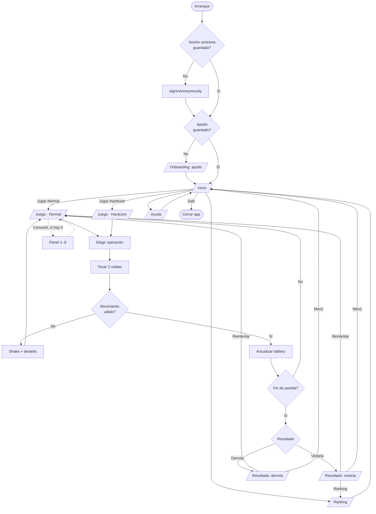
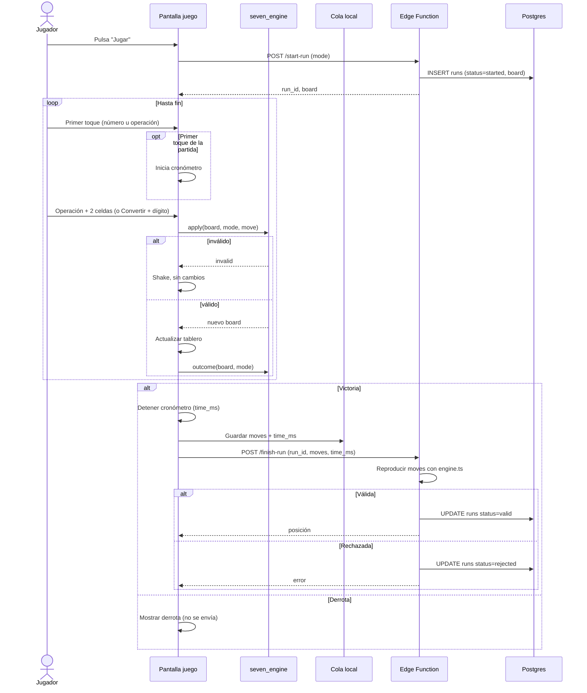
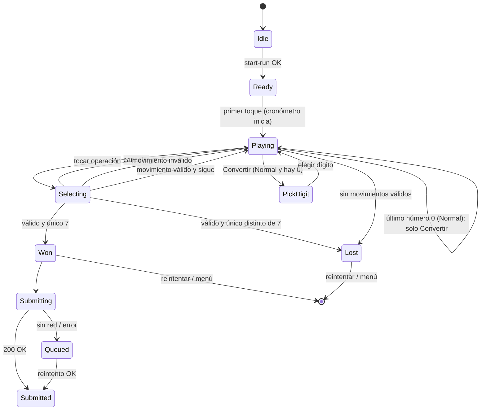

# App Flow — SEVEN

Estado: borrador v0.1 · Fecha: 2026-11-11 · Relacionado: [01-PRD.md](01-PRD.md), [03-UI-UX.md](03-UI-UX.md)

## 1. Mapa de navegación

## 2. Flujo de partida (detallado)

## 3. Estados de la partida

## 4. Flujo de envío y cola offline

1. Al ganar: se guarda en `pending_runs` (JSON) antes de llamar al servidor.
2. Se llama a `finish-run`.
3. Si responde 200 con `valid`: se borra de `pending_runs`.
4. Si responde `rejected`: se borra y se registra en log local (no reintenta).
5. Si falla por red o 5xx: queda en cola.
6. Al iniciar la app y al recuperar conexión (`connectivity_plus`): se reintenta la cola en orden, máximo 3 intentos por entrada con backoff exponencial.

## 5. Flujo de errores

| Error | Pantalla | Acción |
|-------|----------|--------|
| Sin red al iniciar partida | Inicio | Jugar en modo local sin enviar al ranking; aviso "Sin conexión: partida no enviada" |
| Sin red al enviar | Resultado | "Guardado. Se enviará después." |
| Partida rechazada | Resultado | "No se pudo verificar la partida." Sin reintento. |
| Sesión anónima expirada | Cualquiera | Reautenticar en silencio; si falla, continuar sin ranking |

## 6. Permisos y datos

- Ninguno en v1 salvo INTERNET.
- Ningún dato personal recogido. Identificador de sesión anónimo de Supabase.
- Política de privacidad obligatoria en Play Console (URL pública, a publicar en una página sencilla).
