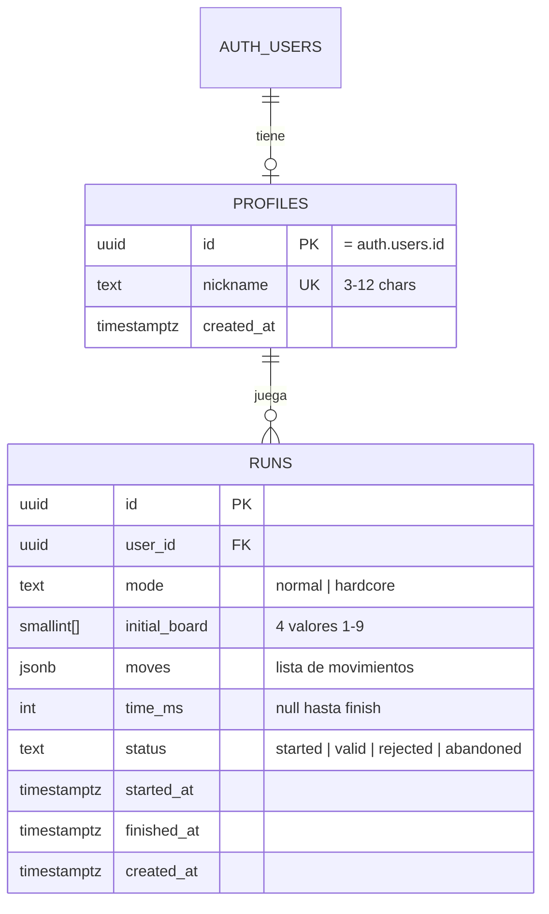

# Backend Schema — SEVEN

Estado: borrador v0.1 · Fecha: 2026-11-11 · Relacionado: [02-TRD.md](02-TRD.md)

Supabase (Postgres 15+). Autenticación anónima. Todas las tablas con RLS.

## 1. Diagrama



## 2. DDL

```sql
-- ============================================================
-- SEVEN — esquema v1
-- ============================================================

create extension if not exists pgcrypto;

-- ---------- Perfiles ----------
create table public.profiles (
  id          uuid primary key references auth.users(id) on delete cascade,
  nickname    text unique check (nickname ~ '^[A-Za-z0-9]{3,12}$'),
  created_at  timestamptz not null default now()
);

-- ---------- Partidas ----------
create type public.game_mode as enum ('normal', 'hardcore');
create type public.run_status as enum ('started', 'valid', 'rejected', 'abandoned');

create table public.runs (
  id             uuid primary key default gen_random_uuid(),
  user_id        uuid not null references public.profiles(id) on delete cascade,
  mode           public.game_mode not null,
  initial_board  smallint[] not null
                   check (array_length(initial_board, 1) = 4
                          and initial_board <@ array[1,2,3,4,5,6,7,8,9]::smallint[]),
  moves          jsonb not null default '[]'::jsonb,
  time_ms        integer check (time_ms is null or time_ms > 0),
  status         public.run_status not null default 'started',
  started_at     timestamptz not null default now(),
  finished_at    timestamptz,
  created_at     timestamptz not null default now(),
  constraint finished_consistent check (
    (status = 'valid' and time_ms is not null and finished_at is not null)
    or status <> 'valid'
  )
);

create index runs_user_idx on public.runs (user_id, created_at desc);

-- Índice del ranking: solo partidas válidas
create index runs_leaderboard_idx
  on public.runs (mode, time_ms)
  where status = 'valid';

-- ---------- Vistas públicas ----------

-- Mejor tiempo por jugador y modo
create or replace view public.best_times as
select distinct on (r.user_id, r.mode)
  r.user_id,
  r.mode,
  r.time_ms,
  r.id as run_id,
  p.nickname
from public.runs r
join public.profiles p on p.id = r.user_id
where r.status = 'valid' and p.nickname is not null
order by r.user_id, r.mode, r.time_ms asc;

-- ---------- Funciones de ranking ----------

create or replace function public.get_leaderboard(
  p_mode  public.game_mode,
  p_limit int default 100,
  p_offset int default 0
)
returns table (position bigint, nickname text, time_ms int, user_id uuid)
language sql stable security definer set search_path = public as $$
  select
    row_number() over (order by bt.time_ms asc, bt.run_id asc) as position,
    bt.nickname,
    bt.time_ms,
    bt.user_id
  from public.best_times bt
  where bt.mode = p_mode
  order by bt.time_ms asc, bt.run_id asc
  limit least(p_limit, 100) offset p_offset;
$$;

create or replace function public.get_my_rank(p_mode public.game_mode)
returns table (position bigint, time_ms int)
language sql stable security definer set search_path = public as $$
  with ranked as (
    select
      row_number() over (order by bt.time_ms asc, bt.run_id asc) as position,
      bt.user_id,
      bt.time_ms
    from public.best_times bt
    where bt.mode = p_mode
  )
  select position, time_ms from ranked where user_id = auth.uid();
$$;

-- ---------- Row Level Security ----------

alter table public.profiles enable row level security;
alter table public.runs     enable row level security;

-- profiles: cada usuario ve y edita su propio perfil
create policy profiles_select_own on public.profiles
  for select using (auth.uid() = id);
create policy profiles_insert_own on public.profiles
  for insert with check (auth.uid() = id);
create policy profiles_update_own on public.profiles
  for update using (auth.uid() = id) with check (auth.uid() = id);

-- runs: solo lectura propia. Escritura solo vía Edge Functions (service role).
create policy runs_select_own on public.runs
  for select using (auth.uid() = user_id);

-- Nickname visible públicamente vía best_times / get_leaderboard (security definer).
-- Los clientes no pueden insertar ni actualizar runs directamente.
revoke insert, update, delete on public.runs from anon, authenticated;

-- Las vistas heredan la seguridad de las tablas base; la función security definer
-- devuelve solo columnas no sensibles.
grant select on public.best_times to anon, authenticated;
grant execute on function public.get_leaderboard(public.game_mode, int, int) to anon, authenticated;
grant execute on function public.get_my_rank(public.game_mode) to authenticated;
```

Nota: `best_times` es una vista sobre `runs`. Si la política de `runs` bloquea a `anon` la lectura, el ranking no funcionará para usuarios no autenticados. Para v1 todos los usuarios son anónimos autenticados, así que el acceso va por `authenticated`. Si se necesita lectura sin sesión, convertir `best_times` en tabla materializada o en función security definer.

## 3. Formato de `moves`

Array JSON en orden de ejecución. Cada elemento:

```json
[
  { "type": "op",      "op": "mul", "i": 2, "j": 3 },
  { "type": "convert", "digit": 7 },
  { "type": "op",      "op": "add", "i": 2, "j": 3 }
]
```

Reglas:
- `op` ∈ `add | sub | mul | div`.
- `i < j`, índices 0–3.
- `convert` solo válido en modo `normal`.
- Los movimientos inválidos **no se guardan**. Solo se persisten movimientos aceptados por el motor.

## 4. Flujo de Edge Functions

### 4.1 `start-run`

Entrada: `{ "mode": "normal" | "hardcore" }` con JWT anónimo.

Pasos:
1. Verificar `auth.uid()` y que existe `profiles` (o crearlo sin nickname).
2. Generar `initial_board` = 4 valores aleatorios 1–9 (`crypto.getRandomValues`).
3. `INSERT runs (user_id, mode, initial_board, status='started')`.
4. Devolver `{ run_id, board, mode, started_at }`.

Límite: máximo 1 partida `started` sin terminar por usuario; las antiguas pasan a `abandoned` al iniciar otra.

### 4.2 `finish-run`

Entrada: `{ run_id, moves, time_ms }`.

Pasos:
1. Cargar `runs` por `run_id` y `user_id`. Debe estar en `status='started'`.
2. Reproducir `moves` sobre `initial_board` con `engine.ts`:
   - Cada movimiento debe ser válido. Si alguno falla → `rejected`.
   - Al terminar, `outcome` debe ser `won`. Si no → `rejected`.
3. Validar tiempo:
   - `elapsed = now() - started_at` (ms).
   - `time_ms ≤ elapsed + 2000` (tolerancia de latencia).
   - `time_ms ≥ min_time[mode]` (3 000 ms normal, 3 000 ms hardcore; ajustar con datos).
4. `UPDATE runs SET moves, time_ms, finished_at=now(), status = 'valid' | 'rejected'`.
5. Devolver `{ status, position? }`. `position` se calcula con `get_my_rank`.

Límite de tamaño: `moves` ≤ 200 elementos.

## 5. Datos de prueba (seed opcional)

```sql
-- Solo en entorno de desarrollo
insert into public.profiles (id, nickname)
values ('00000000-0000-0000-0000-000000000001', 'TestUno');
```

## 6. Migraciones

- Carpeta `supabase/migrations/`.
- Cada cambio de esquema = nuevo archivo con timestamp. Nunca editar migraciones aplicadas.
- Probar localmente con `supabase start` y `supabase db reset`.

## 7. Pendiente

- Decidir si `nickname` es único global (asumido: sí).
- Decidir si se permite cambiar nickname (asumido: sí, sin historial).
- Decidir retención de partidas `rejected` (asumido: 30 días, luego borrado con job).
